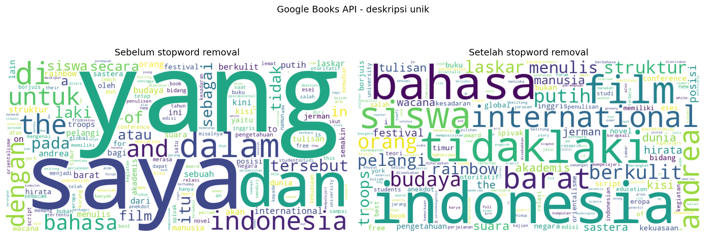
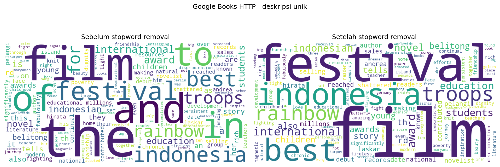
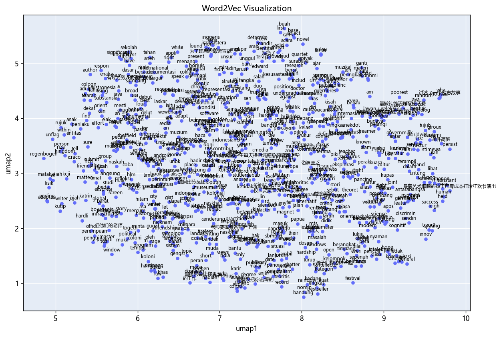
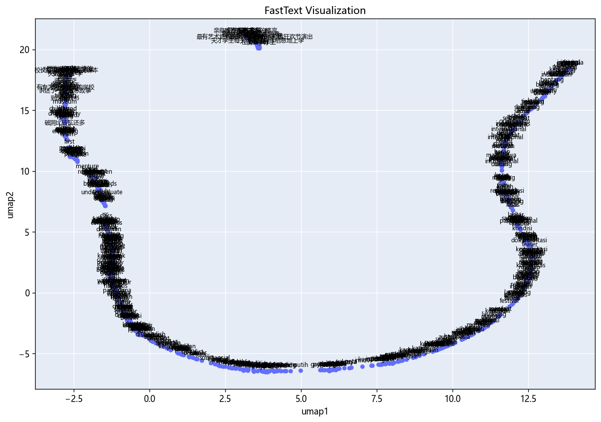
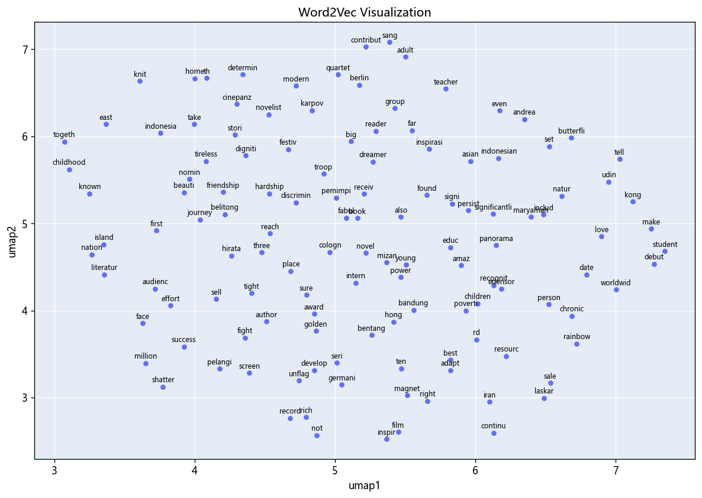
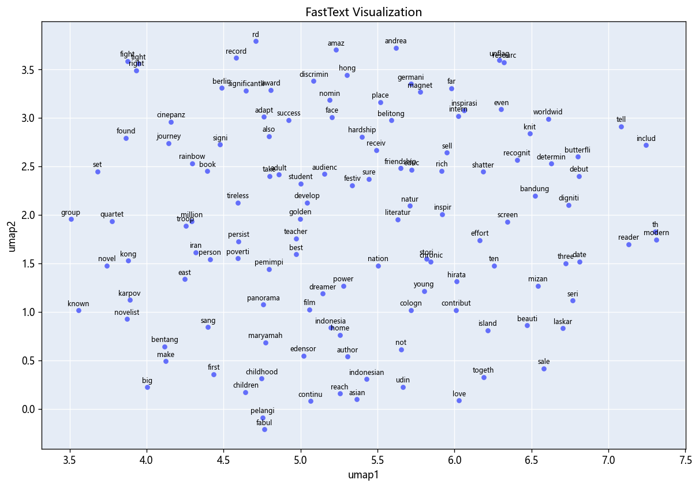
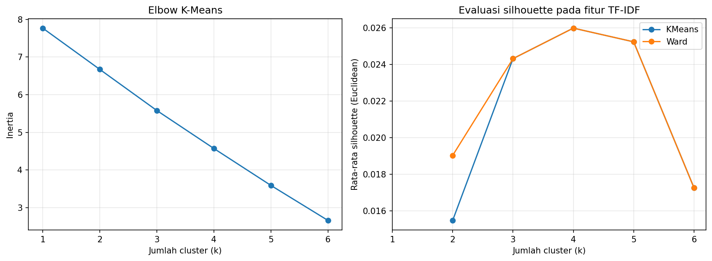
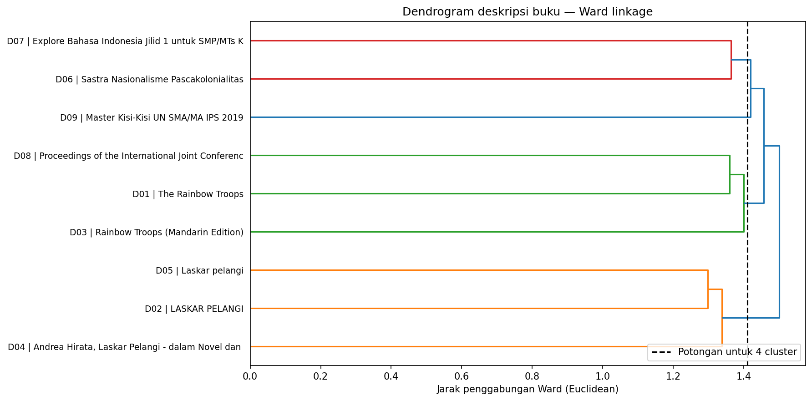
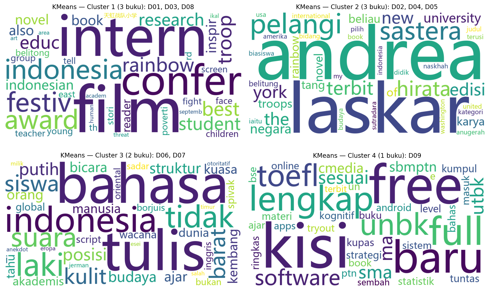

# Google Books Scraping and Text Processing

An educational Python project that collects book metadata using the Google Books REST API and HTML scraping, then cleans and analyzes book descriptions in English and Indonesian. The API workflow applies TF-IDF and cosine similarity in Exercise 6, then K-Means and Hierarchical/Ward text clustering in Exercise 7.

## Authors

**Group 2**

- Muhammad Refi Setyawan — student ID suffix: 159
- Doni Wahana Putra — student ID suffix: 248

## What this project does

| Notebook | Source | Collection workflow |
| --- | --- | --- |
| `01_google_books_api_exercise6_7_tfidf.ipynb` | Google Books API v1 | Searches for a book, inspects a JSON response, and requests up to 10 matching volumes. |
| `02_google_books_http.ipynb` | Google Books website | Requests one book page and extracts metadata using BeautifulSoup, with fallback selectors for the description. |

Both notebooks create a pandas DataFrame and apply the same text-processing pipeline. The API notebook uses the example query `Laskar Pelangi Andrea Hirata`. The HTTP notebook uses volume ID `ZPi96HIG76AC`.

The project processes metadata and descriptions; it does not download complete book contents.

## Repository structure

The notebooks and dependencies are stored in the repository root. Both collection methods have result snapshots included in the repository. The continued API notebook is `01_google_books_api_exercise6_7_tfidf.ipynb`: its original 55 cells, including Exercise 6, are preserved and 20 Exercise 7 cells are appended, giving 75 cells in total.

| Repository path | Purpose |
| --- | --- |
| `README.md` | Project overview, API setup, and execution instructions. |
| `requirements.txt` | Python dependencies. |
| `.gitignore` | Excludes local environments, notebook checkpoints, NLTK downloads, and secret files. |
| `01_google_books_api_exercise6_7_tfidf.ipynb` | API collection, text processing, Exercise 5 feature engineering, Exercise 6 text similarity, and Exercise 7 text clustering. |
| `02_google_books_http.ipynb` | HTML collection, text processing, and Exercise 5 feature engineering. |
| `API_pre-processing_result/google_books_api_preprocessed.csv` | Included API dataset with preprocessing stages. |
| `API_pre-processing_result/frekuensi_kata.csv` | Included API word-frequency table. |
| `API_pre-processing_result/wordcloud.png` | Included API before/after stopword-removal visualization. |
| `Http_pre-processing_result/google_books_http_preprocessed.csv` | Included HTTP preprocessing dataset. |
| `Http_pre-processing_result/word_freequency.csv` | Included HTTP word-frequency table; filename retained as uploaded. |
| `Http_pre-processing_result/wordcloud.png` | Included HTTP before/after stopword-removal visualization. |
| `text_similarity_result/API_TFIDF/` | Optional earlier Exercise 6 exports. The selected notebook displays similarity results in its cells and does not regenerate these files automatically. |
| `text_clustering_result/API_TFIDF/` | Exercise 7 API cluster labels, model evaluation, cluster summaries, fitted models, dendrogram, and word clouds. |

### Included files versus newly generated output

The uploaded result folders and the notebooks' output paths currently have different names. Running the notebooks without changing their code creates:

| Notebook | Default output directory | Generated files |
| --- | --- | --- |
| API | `hasil_text_processing_api/` | `google_books_api_preprocessed.csv`, `frekuensi_kata.csv`, `wordcloud.png` |
| HTTP | `hasil_text_processing_http/` | `google_books_http_preprocessed.csv`, `frekuensi_kata.csv`, `wordcloud.png` |

These directories are relative to `Path.cwd()`. A word cloud is generated only when usable tokens remain after stopword removal.

To write new results into the existing uploaded folders instead, replace the `output_dir` assignment in each notebook's text-processing cell with the corresponding line:

```python
# API notebook
output_dir = Path.cwd() / 'API_pre-processing_result'
```

```python
# HTTP notebook
output_dir = Path.cwd() / 'Http_pre-processing_result'
```

Keep the existing `output_dir.mkdir(exist_ok=True)` line. The HTTP notebook will still export its frequency table as `frekuensi_kata.csv`; the included snapshot is named `word_freequency.csv`.

## Installation

The current notebooks were tested with Python 3.12. Core dependencies are version-pinned in `requirements.txt` and in each notebook's installation cell; some supporting packages are unpinned. Use the listed versions for the supplied results.

Clone the current repository:

```bash
git clone https://github.com/Refest/web_scrapping_google_books.git
cd web_scrapping_google_books
```

If the repository is renamed to `google-books-scraping-text-processing`, use the new address instead:

```bash
git clone https://github.com/Refest/google-books-scraping-text-processing.git
cd google-books-scraping-text-processing
```

From the repository root, create a virtual environment:

```bash
python -m venv .venv
```

Activate it using the command for your platform:

| Platform | Command |
| --- | --- |
| Windows PowerShell | `.venv\Scripts\Activate.ps1` |
| Windows Command Prompt | `.venv\Scripts\activate.bat` |
| macOS / Linux | `source .venv/bin/activate` |

Install dependencies and start Jupyter:

```bash
python -m pip install -r requirements.txt
python -m jupyterlab
```

In VS Code, select the same virtual environment as the notebook kernel. Internet access is needed for Google requests and the first NLTK resource downloads. Exercises 6 and 7 use packages already included in `requirements.txt`; neither requires an additional embedding model or package. Exercise 7 can run from its embedded corpus snapshot without Google Books requests or NLTK resource downloads. Running Exercise 6 alone requires the Exercise 5 corpus in memory or its `corpus.csv` file.

## How to get a Google Books API key

This project accesses public metadata, so an API key is sufficient; an OAuth consent screen is unnecessary for this workflow. See [Google Books authentication guidance](https://developers.google.com/books/docs/v1/using#auth).

1. Sign in to [Google Cloud Console](https://console.cloud.google.com/).
2. Use the project selector to create or select a project, for example `google-books-text-processing`.
3. Open **APIs & Services → Library**, search for **Books API**, and enable it. [Open the Books API page](https://console.cloud.google.com/apis/library/books.googleapis.com).
4. In the same project, open **APIs & Services → Credentials → Create credentials → API key**.
5. Name the key and restrict it to **Books API**. Depending on the console layout, restrictions may appear during creation or on the key's edit page. Save the settings and copy the key privately.
6. For Python notebook requests, use IP restrictions when you have a stable public IP. Website restrictions do not match this client. For temporary local testing, application restrictions can remain unset while the Books API restriction stays enabled.

See [Google's API key management guide](https://cloud.google.com/docs/authentication/api-keys) for current console instructions. Check your project's quota page instead of assuming a fixed daily request limit.

### Configure the API notebook

The supplied notebook contains this placeholder:

```python
api_key = 'GOOGLE BOOK API KEY'
```

For a local session, replace that line with a hidden prompt:

```python
import os
from getpass import getpass

api_key = os.environ.get('GOOGLE_BOOKS_API_KEY') or getpass('Google Books API key: ')
```

Leave `query`, `api_url`, and the request code in place. Enter the key when prompted, or set `GOOGLE_BOOKS_API_KEY` in the environment before launching Jupyter. This change is a setup instruction; the repository notebook still contains its original placeholder.

No `.env` file is loaded automatically by the current notebooks. Creating one alone will not configure the key.

### Check the key

After configuring `api_key`, this optional cell makes a small test request:

```python
import requests

response = requests.get(
    'https://www.googleapis.com/books/v1/volumes',
    params={'q': 'Laskar Pelangi Andrea Hirata', 'maxResults': 1, 'key': api_key},
    timeout=30,
)
payload = response.json()

print('Status code:', response.status_code)
if response.status_code != 200:
    raise RuntimeError(payload.get('error', {}).get('message', 'Request failed'))
if not payload.get('items'):
    raise ValueError('Request succeeded, but no matching books were returned.')
print('Title:', payload['items'][0].get('volumeInfo', {}).get('title'))
```

Do not print the key or the full request URL. Do not commit a real key in notebook source, outputs, or screenshots. If a key has already been published, rotate it in Google Cloud.

## Running the notebooks

1. Launch Jupyter from the repository root and confirm the notebook's working directory with `Path.cwd()` if necessary.
2. Open `01_google_books_api_exercise6_7_tfidf.ipynb`, configure the key, and run cells from top to bottom.
3. Inspect the API response and DataFrame, then run the text-processing cell followed by Exercise 5, Exercise 6, and Exercise 7. The updated API notebook contains separate text-similarity and text-clustering sections. For the Exercise 7 assignment, run the `Exercise 7 — Text Clustering menggunakan TF-IDF` section.
4. Open `02_google_books_http.ipynb` and run its collection, text-processing, and Exercise 5 cells independently. This notebook does not use an API key.
5. Inspect the generated CSV files and word clouds in `hasil_text_processing_api/` and `hasil_text_processing_http/`, unless you changed `output_dir` as described above. Exercise 6 displays text-similarity results inside the notebook. Exercise 7 writes text-clustering results to `text_clustering_result/API_TFIDF/`.

Rerunning a notebook overwrites its generated CSV files and, when usable tokens are available, its word cloud in the configured output directory. Results may differ from the included snapshot because upstream metadata and HTML can change.

## Text-processing pipeline

1. Preserve the original description and flag empty descriptions.
2. Remove HTML and normalize Unicode.
3. Remove hashtags, convert to lowercase, and remove URLs and email addresses.
4. Remove emojis, common emoticons, punctuation, symbols, and numbers.
5. Normalize spaces and split text into tokens.
6. Choose English or Indonesian using stopword-match counts, with book-language metadata as a fallback when available.
7. Remove language-specific stopwords while retaining selected negation words.
8. Apply Porter stemming for English or Sastrawi stemming for Indonesian.
9. Produce a separate POS-aware English WordNet lemmatization column.
10. Export preprocessing stages, token counts, word frequencies, and a word-cloud comparison.

`prepro` uses the stemming output. `lemma_en` is a separate English-only result. Frequent-word and rare-word removal columns are demonstrations and do not replace `prepro`.

Frequency analysis and word clouds use unique nonempty `clean_text` descriptions to avoid counting duplicate descriptions repeatedly. Frequencies are calculated after stopword removal and before stemming. The language-selection method is a heuristic, not a trained language detector.

## Included results

Both API and HTTP result snapshots are included. They show the preprocessing stages, word-frequency analysis, and word-cloud comparison. New runs may produce different results.

### API word cloud



### HTTP word cloud



### Important output columns

Column names remain in the original notebook language.

| Column | Meaning |
| --- | --- |
| `judul`, `deskripsi` | Book title and original description. |
| `penulis`, `kategori`, `terbit` | Authors, categories, and publication date, where collected by the API. |
| `bahasa_buku`, `bahasa_deskripsi` | Book-language metadata and selected description language. |
| `status_processing` | Whether a description is available for processing. |
| `clean_text` | Text after cleaning and whitespace normalization. |
| `tokens`, `tokens_no_stopwords` | Token lists, exported as JSON strings in CSV. |
| `stem`, `lemma_en`, `prepro` | Stemmed text, English lemmas, and the selected final text. |
| `token_sebelum`, `token_setelah` | Whitespace-based token counts before and after processing. |
| `bahasa`, `kata`, `frekuensi` | Language, word, and count in the frequency table. |

## Troubleshooting

| Problem | What to check |
| --- | --- |
| Invalid API key | Configure the real key at runtime and remove the placeholder. |
| API disabled or HTTP 403 | Check the response message, enabled Books API, project, key restrictions, and quota. |
| HTTP 429 or quota error | Inspect project quotas and retry later with fewer requests. |
| No matching books | Change the search query and check whether `items` exists. |
| Missing description or rating | Metadata is optional; an empty field is not automatically a scraping failure. |
| NLTK `LookupError` | Run the resource-setup code in the preprocessing or tokenization cell. It uses local resources or downloads missing ones into `.nltk_data/`; see the NLTK resource setup section below. |
| HTML description not found | Inspect the downloaded page; its structure may have changed or it may be a consent/block page. |
| Files saved elsewhere | Check `Path.cwd()`; output directories are relative to it. |

## Exercise 5: Feature engineering

Exercise 5 continues inside each scraping notebook after the text-processing pipeline. The API notebook creates features from API descriptions, while the HTTP notebook creates features from HTML descriptions. Each source has its own corpus, fitted vectorizers, trained embedding models, and output directory.

### Input data

The feature-engineering section uses the nonempty values in the `prepro` column. It first looks for `df_processed` created by the text-processing cell in the same notebook. This is the normal workflow when running a notebook from beginning to end.

If `df_processed` is unavailable, the section can read the corresponding preprocessing CSV. It checks the newly generated output directory, the included snapshot directory, and the working directory. This alternative lets you run Exercise 5 from an existing dataset without repeating collection and preprocessing.

| Notebook | Included CSV snapshot | Feature output directory |
| --- | --- | --- |
| API | `API_pre-processing_result/google_books_api_preprocessed.csv` | `feature_engineering_result/API/` |
| HTTP | `Http_pre-processing_result/google_books_http_preprocessed.csv` | `feature_engineering_result/HTTP/` |

Running a notebook independently from the beginning does not require these snapshot files. Running only Exercise 5 requires either its own `df_processed` DataFrame or a CSV containing the `prepro` column. Input selection and source information are recorded in the saved metadata.

### Implemented methods

The methods follow the Chapter 5–6 examples in the course notebook.

| Method | Implementation | Output meaning |
| --- | --- | --- |
| Binary encoding | `CountVectorizer(binary=True)` | A sparse matrix showing whether each vocabulary term occurs in a description. |
| Bag of Words | `CountVectorizer()` | A sparse matrix containing vocabulary-term occurrence counts. |
| TF-IDF | `TfidfVectorizer()` | A sparse matrix of term weights based on frequency within a description and across the source corpus. |
| Word2Vec CBOW | Gensim `Word2Vec` with `sg=0` | Learned 100-dimensional word vectors and mean word-vector representations of descriptions. |
| FastText Skip-Gram | Gensim `FastText` with `sg=1` | Learned 100-dimensional word vectors using character subwords, plus mean word-vector representations of descriptions. |

Word2Vec and FastText use `nltk.word_tokenize(text.lower())` to prepare sentences from `prepro`. Document vectors are calculated by averaging the vectors of the document's tokens that are present in the model vocabulary. If no such tokens are available, the helper returns a zero vector.

### Model settings

| Setting | Word2Vec | FastText |
| --- | --- | --- |
| Architecture | CBOW (`sg=0`) | Skip-Gram (`sg=1`) |
| Vector dimensions | 100 | 100 |
| Context window | 5 | 5 |
| Minimum word count | 1 | 1 |
| Training epochs | 5 | 10 |
| Random seed | 1 | 1 |
| Workers | 1 | 1 |
| Character subword lengths | — | 3–6 |
| Subword buckets | — | 20,000 |

The reduced FastText bucket count keeps saved models compact. The model configuration is recorded in `parameters.json` for each source. The vectorizers use single-word features; character subwords are part of the FastText model.

## UMAP visualizations

Each notebook includes two UMAP scatter plots: one for Word2Vec and one for FastText. UMAP reduces the learned word vectors to two coordinates so their positions can be inspected visually. Each point represents a vocabulary word, and all word labels are displayed.

The projection uses `random_state=42`, one worker, Euclidean distance, and a requested neighborhood size of 15. API and HTTP projections are computed independently from their own models.

Each plot is available in three forms:

- A notebook output containing a static PNG and an interactive Plotly figure.
- An HTML file that can be opened in a browser for zooming, panning, and hovering.
- A CSV file containing each word and its UMAP coordinates.

The PNG and interactive figure use the same coordinates. Files are named `word2vec_umap.png`, `word2vec_umap.html`, and `word2vec_umap.csv`, with equivalent names for FastText, inside each source's feature output directory.

### API embedding plots





### HTTP embedding plots





## Feature-engineering files and supporting resources

The following paths extend the repository structure described above.

| Path | Contents |
| --- | --- |
| `feature_engineering_result/API/` | Features, models, vocabulary tables, metadata, and UMAP plots derived from API preprocessing. |
| `feature_engineering_result/HTTP/` | Features, models, vocabulary tables, metadata, and UMAP plots derived from HTTP preprocessing. |
| `nltk_data/` | Optional bundled NLTK resources for local use without downloading them again. |
| `verification.json` | Results of checks on saved features, source separation, embedding models, notebook outputs, and resource setup. |
| `artifact_manifest.csv` | Package file sizes and SHA-256 checksums. |

Both feature output directories contain the following file groups:

| Files | Purpose |
| --- | --- |
| `corpus.csv`, `metadata.csv` | Selected descriptions, document IDs, original source rows, and source labels. |
| `binary_features.npz`, `bow_features.npz`, `tfidf_features.npz` | Saved sparse feature matrices. Rows represent descriptions; columns correspond to vocabulary entries. |
| `binary_vectorizer.joblib`, `bow_vectorizer.joblib`, `tfidf_vectorizer.joblib` | Fitted vectorizers used to produce the saved matrices. |
| `binary_vocabulary.csv`, `bow_vocabulary.csv`, `tfidf_vocabulary.csv` | Vocabulary terms and their feature indices. |
| `word2vec.model`, `fasttext.model` | Saved embedding models. |
| `word2vec_word_vectors.npy`, `fasttext_word_vectors.npy` | Word embeddings in model vocabulary order. |
| `word2vec_document_vectors.npy`, `fasttext_document_vectors.npy` | Mean embedding vectors with one row per description and 100 columns. |
| `word2vec_vocabulary.csv`, `fasttext_vocabulary.csv` | Words corresponding to the rows in each word-vector array. |
| `word2vec_umap.*`, `fasttext_umap.*` | UMAP coordinate tables, interactive HTML plots, and static PNG images. |
| `parameters.json`, `execution_status.json` | Source, input mode, model settings, execution status, and dependency versions. |
| `artifact_manifest.csv` | File sizes and checksums for that source's generated artifacts. |

## Exercise 6: Text similarity with TF-IDF

The existing Exercise 6 section is preserved from `01_google_books_api_exercise6_tfidf.ipynb`. It follows the Chapter 7 cosine-similarity examples and compares the same `prepro` descriptions used for feature engineering. Its eight code cells display a document list, TF-IDF dimensions, a similarity matrix, a heatmap, the top document pairs, the nearest document for each book, and two query rankings.

### Input and execution

The section uses the Exercise 5 `corpus` DataFrame when it is already available. Otherwise, it reads `corpus.csv` from `RESULT`, defaulting to `feature_engineering_result/API/`. It then recomputes TF-IDF using `TfidfVectorizer()` and calculates cosine similarity. This selected version of Exercise 6 does not contain an embedded-data fallback.

To run Exercise 6 alone:

1. Install the notebook dependencies and open the continued API notebook.
2. Provide `feature_engineering_result/API/corpus.csv` under the working directory, or first run Exercise 5 to create `corpus` in memory.
3. Run the cells under **Exercise 6**, stopping at the next exercise heading if you only need similarity.
4. Inspect the similarity matrix, pair rankings, nearest-document table, and query results.

The `Lanjutan_Exercise6_7_TFIDF.zip` package includes the feature input files required to run the existing Exercise 6 section without repeating collection. Extract the package and use its directory as the working directory. Running only Exercise 7 does not require those companion files because that section includes its own snapshot fallback.

### Similarity and query workflow

- Convert the preprocessed descriptions to TF-IDF vectors.
- Compute `cosine_similarity` between all document vectors and display the labeled matrix and heatmap.
- Rank unique pairs using the matrix's upper triangle, excluding self-comparisons and reversed duplicates.
- Display the mean and maximum pair similarity and the number of zero-score pairs.
- Identify the nearest other document for every book.
- Transform each query using the fitted vectorizer and display the five highest-scoring documents.

The sample queries are `andrea hirata laskar pelangi` and `rainbow troop novel`, already written in the form expected after preprocessing. The existing query code takes the top five rows even when the fifth score is zero. A zero-score row has no matching vocabulary features and should not be interpreted as a positive match.

### Included Exercise 6 results

| Measure | API snapshot result |
| --- | --- |
| Descriptions / TF-IDF features | 9 / 807 |
| Unique pairs, excluding self-comparisons | 36 |
| Highest-scoring pair | D02 (`LASKAR PELANGI`) and D05 (`Laskar pelangi`) |
| Highest pair score | 0.1569 |
| Mean / median pair score | 0.0292 / 0.0099 |
| Zero-score pairs | 11 |
| Top result for `andrea hirata laskar pelangi` | D05, score 0.4867 |
| Top result for `rainbow troop novel` | D01 (`The Rainbow Troops`), score 0.2314 |

The supplied results use the nine-description Exercise 5 snapshot with 807 TF-IDF features. The earlier saved Chapter 4 output showing six valid descriptions comes from a different API run. Similarity scores describe lexical overlap and do not measure the probability that books share a topic.

### Previously exported similarity files

If the earlier `hasil_exercise6_text_similarity_tfidf.zip` package is already part of the repository, its `text_similarity_result/API_TFIDF/` directory may be retained. Those files were exported from the earlier extended similarity version. The selected 75-cell notebook keeps its original Exercise 6 output in notebook cells and does not automatically write or update these eight files:

| File in `text_similarity_result/API_TFIDF/` | Contents |
| --- | --- |
| `cosine_similarity_matrix.csv` | Full square matrix labeled by document ID; one row and column per description. |
| `pasangan_dokumen.csv` | All unique document pairs, their book titles, and cosine scores in descending order. |
| `statistik_similarity.csv` | Pair count, mean, median, maximum, and number of zero-score pairs. |
| `ringkasan_dokumen.csv` | Document IDs, book titles, original source rows, token counts, and nonzero feature counts. |
| `kontribusi_pasangan_teratas.csv` | Shared vocabulary, normalized TF-IDF weights, and per-word contributions for the highest-scoring pair. |
| `query_andrea_hirata.csv` | Ranked positive-score matches for `andrea hirata laskar pelangi`. |
| `query_rainbow_troop.csv` | Ranked positive-score matches for `rainbow troop novel`. |
| `heatmap_cosine_similarity.png` | Labeled heatmap of the document-similarity matrix. |

The earlier exports use UTF-8 with BOM. Their presence is optional for Exercise 7. The clustering exercise uses the TF-IDF feature matrix rather than these similarity-output files.

## Exercise 7: Text clustering with TF-IDF

**Colab assignment:** continue the feature-engineering work, apply the clustering methods from Chapter 8, analyze the results, and submit the GitHub repository link through Sidia.

Exercise 7 is a separate section after Exercise 6 in the continued API notebook. It groups book descriptions using the TF-IDF vectors from Exercise 5. The earlier similarity section remains intact; clustering operates on the feature matrix directly. The appended section contains 10 code cells and 10 markdown cells.

### Implemented clustering methods

| Method | Configuration | Input |
| --- | --- | --- |
| K-Means | `KMeans(random_state=10, n_init=20)`; cluster count selected from the candidate scores. | All TF-IDF features of the preprocessed API descriptions. |
| Hierarchical/Ward | `AgglomerativeClustering(linkage='ward', metric='euclidean')`; the same candidate range is evaluated. | The same TF-IDF matrix, converted to dense form for this small corpus. |

These are the two clustering methods demonstrated in the supplied course notebook. The supervised sentiment-classification example in that chapter is not part of the clustering exercise.

### Input and standalone execution

The section first tries Exercise 5's `corpus.csv`, `tfidf_features.npz`, and `tfidf_vectorizer.joblib` from the current `RESULT` directory or `feature_engineering_result/API/`. It checks that the matrix agrees with the fitted vectorizer and the corpus row order.

If those files are missing, the section uses an available in-memory corpus and recomputes TF-IDF with the Exercise 5 defaults. On a new kernel without companion files, it uses an embedded copy of the same nine-document corpus. The included feature matrix contains 807 features. Book titles are labels in the result tables; clustering uses the `prepro` descriptions.

To run only Exercise 7 in Colab:

1. Upload `01_google_books_api_exercise6_7_tfidf.ipynb` and install its dependencies. The existing installation cell or `requirements.txt` contains the required packages. A minimal install for this section is `%pip install pandas numpy scipy scikit-learn==1.6.1 matplotlib joblib wordcloud ipython`.
2. Locate **Exercise 7 — Text Clustering menggunakan TF-IDF**.
3. Run every cell from that heading onward, including the collapsed snapshot cell.
4. Inspect the candidate scores, chosen cluster counts, book assignments, dendrogram, dominant words, and word clouds.
5. Run the final saving cell and download `text_clustering_result/API_TFIDF/` before the Colab runtime is cleared.
6. Add the updated notebook and result folder to the GitHub repository. Submit the repository link through Sidia according to the assignment instructions.

Running this section from the embedded snapshot does not require an API key, live collection, NLTK downloads, Exercise 6 execution, or retraining Word2Vec/FastText. Dependencies must already be installed. The `Lanjutan_Exercise6_7_TFIDF.zip` package includes the continued API notebook, its feature input files, and clustering results. When adding it to the existing repository, keep the HTTP notebook and earlier artifacts. Add this README as the repository's `README.md`.

### Cluster-count selection and evaluation

The supplied snapshot evaluates K-Means inertia for k=1 through 6 and Euclidean silhouette scores for both methods at k=2 through 6. The upper bound is reduced when a smaller input corpus requires it.

Each method selects the candidate with the highest mean silhouette score; an exact tie chooses the smaller k. The elbow curve is shown as an additional check. Both methods and the silhouette metric use Euclidean geometry, consistent with Ward linkage. No dimensionality reduction is used before clustering or scoring.

Cluster IDs are arbitrary. For readable comparison, displayed cluster numbers begin at 1 and are ordered by the first document appearing in each cluster. Raw model labels and their mapping are also saved. Adjusted Rand Index (ARI) measures agreement between the methods without depending on their label numbers.

### Included Exercise 7 results

| Measure | K-Means | Hierarchical/Ward |
| --- | --- | --- |
| Input | 9 descriptions, 807 TF-IDF features | Same input |
| Selected number of clusters | 4 | 4 |
| Mean Euclidean silhouette | 0.025982 | 0.025982 |
| Cluster sizes | 3, 3, 2, 1 | 3, 3, 2, 1 |
| Clusters containing one document | 1 | 1 |

Both methods produce the same membership on this snapshot (ARI = 1.0):

| Displayed cluster | Documents | Books |
| --- | --- | --- |
| 1 | D01, D03, D08 | The Rainbow Troops; Rainbow Troops (Mandarin Edition); IJCAH 2022 proceedings. |
| 2 | D02, D04, D05 | LASKAR PELANGI; Andrea Hirata, Laskar Pelangi - dalam Novel dan Film; Laskar pelangi. |
| 3 | D06, D07 | Sastra Nasionalisme Pascakolonialitas; Explore Bahasa Indonesia Jilid 1 untuk SMP/MTs Kelas VII. |
| 4 | D09 | Master Kisi-Kisi UN SMA/MA IPS 2019. |

The silhouette scores are close to zero, so these groups are weakly separated. Agreement between methods does not establish clustering accuracy. For example, conference proceedings appear in the same group as two Rainbow Troops descriptions. Nine short or uneven, multilingual descriptions provide limited evidence for stable topic groups. The analysis is exploratory and does not report classification accuracy or claim that four clusters are universally optimal.

### Clustering visualizations








Dominant-word tables use mean TF-IDF weights per cluster. Word clouds use token frequencies within each cluster, following the course example. The dendrogram includes a marked cut corresponding to the selected Ward cluster count.

### Exercise 7 output files

Extract `hasil_exercise7_text_clustering_tfidf.zip` into the repository root, preserving `text_clustering_result/API_TFIDF/`. This directory contains 17 files:

| File | Contents |
| --- | --- |
| `hasil_clustering.csv` | Corpus metadata and preprocessed descriptions, raw labels, displayed cluster IDs, and per-document silhouette values for both methods. |
| `evaluasi_jumlah_cluster.csv` | Euclidean silhouette, cluster sizes, and singleton counts for both methods at each candidate k. |
| `elbow_kmeans.csv` | K-Means inertia at each tested k. |
| `perbandingan_model.csv` | Selected k and evaluation summary for each method. |
| `ringkasan_cluster.csv` | Members, titles, document counts, and dominant words for every cluster. |
| `kata_teratas_cluster.csv` | Ranked dominant words and mean TF-IDF weights for every cluster. |
| `silhouette_per_dokumen.csv` | Long-form per-document silhouette table for both methods. |
| `ward_linkage.npy` | SciPy Ward linkage matrix used for the dendrogram. |
| `kmeans_model.joblib`, `ward_model.joblib` | Fitted clustering models. The saved Ward model describes the fitted corpus and has no `predict` method for new documents. |
| `elbow_dan_silhouette.png` | Cluster-count evaluation plots. |
| `dendrogram_ward.png` | Ward merge hierarchy and selected cut. |
| `wordcloud_kmeans.png`, `wordcloud_ward.png` | Word clouds for all selected clusters. |
| `parameters.json` | Feature source, candidate range, selected settings, displayed-label mappings, and agreement between methods. |
| `execution_status.json` | Execution status, input mode, document count, timestamp, and actual package versions. |
| `artifact_manifest.csv` | Artifact names, sizes, and SHA-256 checksums. |

CSV files use UTF-8 with BOM. Rerunning the saving cell overwrites the generated files. Keep the input `corpus.csv` and fitted TF-IDF vectorizer from the same feature-engineering run as the saved models.

### Exercise 7 validation and dependencies

The selected notebook's eight Exercise 6 code cells and the ten appended Exercise 7 code cells were executed in sequence. Checks confirmed that both sections use the same 9-by-807 TF-IDF matrix, the 55 original cells and outputs remain identical, reloaded models agree with exported labels, and silhouette scores agree with the assignments. The same Exercise 7 implementation was also checked with its standalone snapshot and with SciPy/scikit-learn Ward partitions.

No new package is needed: `scikit-learn` provides both clustering methods and the metrics, `scipy` provides Ward linkage and the dendrogram, `matplotlib` and `wordcloud` provide plots, and the existing `pandas`, `numpy`, `joblib`, and `ipython` entries support data handling, saved models, and notebook output. Existing requirements and version pins are retained. The execution-status file records the versions actually used for the supplied run.

## Running an individual notebook in Google Colab

Either notebook can be uploaded to Colab on its own. You do not need to upload the complete project folder when running collection, preprocessing, and feature engineering in sequence.

1. Upload `01_google_books_api_exercise6_7_tfidf.ipynb` or `02_google_books_http.ipynb` to Colab.
2. Run the `%pip install` cell under the library heading. This cell contains the required packages, so a separate `requirements.txt` upload is unnecessary.
3. Restart the session if required after installation, then run the notebook cells from the beginning.
4. For the API notebook, configure your Google Books API key before running requests. The HTTP notebook does not require an API key.
5. Run collection and preprocessing before Exercise 5. The feature section uses the resulting `df_processed` DataFrame directly.
6. In the updated API notebook, continue with Exercise 6 and Exercise 7 after Exercise 5. Exercise 6 produces similarity results; Exercise 7 produces clustering results. Exercise 7 can run independently from its embedded corpus snapshot. Exercise 6 alone requires the Exercise 5 corpus in memory or `corpus.csv`.
7. Inspect the tables and UMAP plots, then download generated files from the runtime if you need to keep them. Exercise 6 displays results inside the notebook; Exercise 7 exports 17 clustering artifacts to `text_clustering_result/API_TFIDF/`.

Internet access is required for package installation, Google Books requests, and the first download of missing NLTK resources. Generated files are stored relative to the runtime's working directory; retain a copy before the temporary runtime is cleared.

To run Exercise 5 alone from the included snapshots, provide the corresponding preprocessing CSV or extract the full package into the runtime and use its directory as the working directory. A notebook's previously saved outputs do not restore Python variables in a fresh session. To run Exercise 6 alone, provide `feature_engineering_result/API/corpus.csv` or run Exercise 5 first. To run Exercise 7 alone, run all cells from its heading, including its embedded snapshot cell.

## NLTK resource setup

The notebooks first use an existing `nltk_data/` directory in the working directory, the extracted package directory, or the working directory's parent. Otherwise, they use a `.nltk_data/` cache in the working directory.

Missing resources are downloaded from a fixed version of the official NLTK Data repository. Each downloaded archive is checked against its expected SHA-256 checksum, and archive paths are validated before writing files. Setup does not use `nltk.download()` or disable NLTK's security settings.

| Resource | Used for |
| --- | --- |
| `stopwords` | English and Indonesian stopword lists. |
| `wordnet` | POS-aware English lemmatization. |
| `averaged_perceptron_tagger_eng` | English part-of-speech tags used during lemmatization. |
| `punkt_tab` | Sentence and word tokenization for embedding input. |

The bundled `nltk_data/corpora/wordnet.zip` is intentionally kept as a ZIP file. NLTK reads it directly, so manual extraction is unnecessary. English tokenizer data and English/Indonesian stopwords are sufficient for the current pipeline. Provenance information and upstream documentation are included with the bundled resources.

The bundled folder is optional for a standalone notebook with internet access. Once resources have been downloaded into the runtime cache, subsequent resource checks reuse them without downloading again. `.gitignore` excludes the generated `.nltk_data/` cache; the optional bundled `nltk_data/` folder has a different name.

## Included feature results and validation

The included Exercise 5 results were computed independently from the preprocessing snapshots:

| Source | Nonempty descriptions | Embedding vocabulary words | Completed feature code cells | UMAP plots |
| --- | --- | --- | --- | --- |
| API | 9 | 813 | 11 | 2 |
| HTTP | 1 | 127 | 11 | 2 |

The saved Chapter 4 API output comes from an earlier run showing 6 valid descriptions, while the included API CSV snapshot has 9. The feature results use the CSV snapshot, and the selected input mode is recorded in their metadata. A fresh run uses its own newly collected data instead.

Validation checks confirmed that saved sparse matrices match their vectorizers, embedding arrays match the saved models, document vectors match the means of token vectors, source data remain separate, and UMAP image and interactive outputs are present.

Resource setup, preprocessing, the feature input loader, and tokenization were also tested from separate empty directories without companion files for both sources. Local bundled resource setup was tested with network access blocked. These checks did not rerun live Google Books requests or test the Colab service directly.

The HTTP snapshot contains only one description. Its TF-IDF inverse-document-frequency values are all 1, and its embeddings are trained from that single description. The included counts describe the supplied snapshots; collection results and model outputs may change on later runs.

### Additional troubleshooting

| Problem | What to check |
| --- | --- |
| Google Books API returns HTTP 503 | The service reports temporary unavailability. Wait and rerun the request cell; the response alone does not establish that the key is invalid. |
| Feature input is missing | Run the notebook's preprocessing cell first, or provide the matching source CSV. Saved notebook outputs do not create `df_processed` in a fresh runtime. |
| NLTK resource download fails | Check internet access, then rerun the resource-setup cell. Alternatively, use the bundled `nltk_data/` folder. |
| NLTK archive checksum does not match | The downloaded bytes differ from the expected official archive. Retry the cell or use the bundled resources. |
| Package import fails after installation | Restart the kernel/session and rerun the imports using the environment where the install cell ran. |
| UMAP is not interactive in the notebook viewer | Use the embedded PNG for a static view or open the corresponding HTML file in a browser. |
| Output changes after rerunning | Check which source data and input mode were used; new collection results can differ from the included snapshot. |
| Exercise 6 cannot find `corpus.csv` | Run Exercise 5 first or extract its corpus CSV under `feature_engineering_result/API/` in the working directory. |
| Exercise 6 result directory is not created | The preserved Exercise 6 section displays its outputs in notebook cells. The earlier similarity ZIP is optional and is not regenerated by this version. |
| Exercise 6 query includes a zero-score result | The existing query code always takes the top five rows. Inspect each score; zero indicates no vocabulary overlap with the query. |
| Exercise 7 result folder is missing | Run its final saving cell and inspect `Path.cwd() / "text_clustering_result" / "API_TFIDF"`. |
| Exercise 7 silhouette is close to zero | Inspect the memberships and feature vocabulary; do not infer strong topic groups from the number of clusters alone. |
| Word-cloud text shows missing Chinese glyphs | Use a CJK-capable font through the word-cloud `font_path`. The notebook checks common local font paths; the clustering matrix still retains all vocabulary features. |

## References

- [Google Books API documentation](https://developers.google.com/books/docs/v1/using)
- [Google Books API volume search reference](https://developers.google.com/books/docs/v1/reference/volumes/list)
- [Google Cloud API key management](https://cloud.google.com/docs/authentication/api-keys)
- [scikit-learn TfidfVectorizer](https://scikit-learn.org/stable/modules/generated/sklearn.feature_extraction.text.TfidfVectorizer.html)
- [scikit-learn cosine_similarity](https://scikit-learn.org/stable/modules/generated/sklearn.metrics.pairwise.cosine_similarity.html)
- [scikit-learn KMeans](https://scikit-learn.org/1.6/modules/generated/sklearn.cluster.KMeans.html)
- [scikit-learn AgglomerativeClustering](https://scikit-learn.org/1.6/modules/generated/sklearn.cluster.AgglomerativeClustering.html)
- [scikit-learn silhouette_score](https://scikit-learn.org/1.6/modules/generated/sklearn.metrics.silhouette_score.html)

Book descriptions and metadata come from Google Books and their respective providers. This repository is an educational project; no redistribution license for third-party content is implied.
